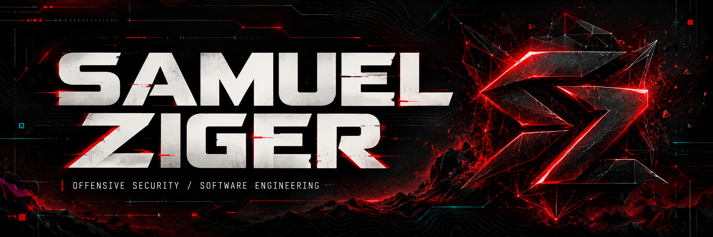

<p align="right">
  <a href="./README.md">PT-BR</a> &nbsp; / &nbsp; <strong>EN</strong>
</p>

<p align="center">
  
</p>

<p align="center">
  
</p>

<p align="center">
  <strong>Understand the vulnerability. Demonstrate the impact. Build the fix.</strong>
</p>

<p align="center">
  <a href="https://github.com/Samuel-Ziger/Certificado/blob/main/Pentest/CRTA.pdf"></a>
  &nbsp;
  <a href="https://github.com/Samuel-Ziger/Certificado/blob/main/Pentest/Solyd-SYCP.pdf"></a>
</p>

<p align="center">
  <a href="https://www.linkedin.com/in/samuel-ziger-237524357/">LinkedIn</a>
  &nbsp; · &nbsp;
  <a href="mailto:samuelziger01@gmail.com">Email</a>
  &nbsp; · &nbsp;
  <a href="https://github.com/Samuel-Ziger/Certificado">Certificates</a>
</p>

<p align="center">
  <a href="#profile">PROFILE</a> &nbsp; / &nbsp;
  <a href="#projects">PROJECTS</a> &nbsp; / &nbsp;
  <a href="#toolbox">STACK</a> &nbsp; / &nbsp;
  <a href="#experience">EXPERIENCE</a> &nbsp; / &nbsp;
  <a href="#credentials">CERTIFICATIONS</a> &nbsp; / &nbsp;
  <a href="#contact">CONTACT</a>
</p>

<p align="center">
  
</p>

<a name="profile"></a>

## `01 / whoami`

I'm **Samuel Ziger**, a pentester, security researcher and Full Stack developer.

My work connects **offensive security and software engineering**. I investigate applications, validate vulnerabilities and build tools that turn scattered information into technical evidence and verifiable fixes.

```yaml
name: Samuel Ziger
roles: [Pentester, Security Researcher, Full Stack Developer]
focus: [Web Security, Recon, OSINT, Red Team, Automation]
credentials: [CRTA, SYCP]
approach: "Understand the cause. Validate the impact. Support the fix."
```

---

<a name="projects"></a>

## `02 / projects`

### [GHOSTRECON](https://github.com/Samuel-Ziger/GHOSTRECON)

`RECON` `OSINT` `AUTOMATION`

A reconnaissance platform for authorized operations. Automates collection, correlates sources and organizes attack surface mapping into technical reports.

### [SetupRedTeam](https://github.com/Samuel-Ziger/SetupRedTeam)

`ENVIRONMENT SETUP` `WINDOWS` `KALI LINUX`

Standardized environment setup for pentesting and Red Team work. Automates tool installation and makes the working environment easier to reproduce.

### [RootID](https://github.com/Samuel-Ziger/RootId)

`OSINT` `AI` `CORRELATION`

Contextual analysis of public data with **Serper.dev** and **Google Gemini**. Combines information correlation with reliability and risk indicators.

### [RedTeam Essentials](https://github.com/Samuel-Ziger/RedTeam-Essentials)

`PLAYBOOKS` `CHEATSHEETS` `METHODOLOGY`

An offensive security learning resource with learning paths, playbooks, cheatsheets, **MITRE ATT&CK** references and report templates.

### [Cybersecurity Course](https://github.com/Samuel-Ziger/CursoSegurancaCibernetica)

`SECURITY AWARENESS` `SOCIAL ENGINEERING` `ACCOUNT SECURITY`

Content on phishing, social engineering, OSINT and best practices for protecting people, accounts and organizations.

<p align="right">
  <a href="https://github.com/Samuel-Ziger?tab=repositories"><strong>Explore all repositories →</strong></a>
</p>

---

<a name="toolbox"></a>

## `03 / toolbox`

| Area | Tools and knowledge |
| :--- | :--- |
| **Languages** | Python · Java · JavaScript · TypeScript · Bash |
| **Web development** | Vue.js · React · HTML · CSS · Bootstrap · Spring Boot · REST APIs |
| **Data and backend** | Relational databases · Firebase · ORM |
| **Web security** | Burp Suite · OWASP ZAP · Postman · OWASP Top 10 |
| **Networking and exploitation** | Nmap · Wireshark · Metasploit · Aircrack-ng |
| **Reconnaissance and OSINT** | Shodan · Censys · theHarvester · Serper.dev · OSINT frameworks |
| **Infrastructure** | Linux · Kali Linux · Windows · Docker · Kubernetes · Networking · Hardening |
| **Version control** | Git · GitHub · GitLab |
| **AI and automation** | Google Gemini · LLMs · Python automation |

**Additional knowledge:** C# and Go.

---

<a name="experience"></a>

## `04 / experience`

### A Divisão

**Pentester and Developer** · Solutions hub for military personnel  
`2025 — Present`

- Web application testing based on the OWASP Top 10, evidence documentation and support for vulnerability mitigation.
- Development of corporate OSINT tools with AI and automation for collection, analysis and technical reporting.

### Photo Now

**Full Stack Developer** · Self-service technology and solutions  
`2025 — Present`

- Development and maintenance of web applications, integrating frontend, APIs and backend services.
- Backend development with Java and support for deployment, infrastructure and application security.

### Bug Bounty

**Independent Researcher** · Programs with authorized scope  
`2025 — Present`

- Reconnaissance, application analysis and technical validation of vulnerabilities.
- Responsible reporting and ongoing research into web security and bug bounty methodologies.

### Brazilian Army

**Military service · Infrastructure, networking and technical support**  
`2022 — 2026`

- Administration, maintenance and hardening of networks and systems.
- Technical incident diagnosis, task coordination and team leadership.

---

<a name="credentials"></a>

## `05 / credentials`

### CRTA · Certified Red Team Analyst

**CyberWarFare Labs** · October 2026

A practical offensive security certification focused on reconnaissance, vulnerability exploitation and techniques applied to Red Team operations.

**[View CRTA certificate →](https://github.com/Samuel-Ziger/Certificado/blob/main/Pentest/CRTA.pdf)**

### SYCP · Solyd Certified Pentester

**Solyd Offensive Security** · June 2026

A practical certification in web pentesting, controlled vulnerability exploitation, evidence documentation and technical reporting.

**[View SYCP certificate →](https://github.com/Samuel-Ziger/Certificado/blob/main/Pentest/Solyd-SYCP.pdf)**

**[View certificate portfolio →](https://github.com/Samuel-Ziger/Certificado)**

<details>
<summary><strong>Additional certifications · IBSEC</strong></summary>

- **[Cybersecurity Fundamentals](https://github.com/Samuel-Ziger/Certificado/blob/main/Fundamentos/Fundamentos%20em%20Ciberseguran%C3%A7a.pdf)** · March 2026.
- **[Cybersecurity Best Practices — Cybersecurity Awareness](https://github.com/Samuel-Ziger/Certificado/blob/main/Fundamentos/Boas%20Praticas%20de%20%20ciberseguran%C3%A7a.pdf)** · March 2026.

Issued by the **Brazilian Institute of Cybersecurity (IBSEC)** after passing a knowledge and skills examination.

</details>

### Systems Analysis and Development

**Estácio** · 2024 — 2026

<details>
<summary><strong>Additional training</strong></summary>

- **Cisco Networking Academy:** Ethical Hacker, Cyber Threat Management and Introduction to Cybersecurity.
- **Solyd Offensive Security:** web security, reconnaissance, infrastructure, Active Directory, post-exploitation and Bug Bounty automation.
- **Desec Security:** Introduction to Practical Pentesting.
- **Hacking Club:** Hacking for Beginners.
- **DIO:** AI fundamentals, LLMs and prompt engineering.

</details>

---

<a name="knowledge"></a>

## `06 / knowledge`

Through **Zona de Segurança Digital**, I create content to help people recognize scams and protect their accounts, data and transactions.

This work covers phishing, social engineering, authentication, Pix, privacy and social media security.

**[TikTok · @zonadesegurancadigital →](https://www.tiktok.com/@zonadesegurancadigital)**

---

<a name="telemetry"></a>

## `07 / telemetry`

**[Public repositories](https://github.com/Samuel-Ziger?tab=repositories)** · **[Profile activity](https://github.com/Samuel-Ziger)**

<details>
<summary><strong>Expand public GitHub statistics</strong></summary>

<p align="center">
  
</p>

<p align="center">
  
</p>

The languages shown reflect the code in public repositories and do not, on their own, represent proficiency.

</details>

---

<a name="contact"></a>

## `08 / connect`

**Security, development and research. Let's talk.**

<p>
  <a href="https://www.linkedin.com/in/samuel-ziger-237524357/"></a>
  &nbsp;
  <a href="mailto:samuelziger01@gmail.com"></a>
  &nbsp;
  <a href="https://github.com/Samuel-Ziger"></a>
</p>

**Email:** [samuelziger01@gmail.com](mailto:samuelziger01@gmail.com)

> **Responsible research.** Security work featured in this profile is carried out in labs, on owned assets or on systems with formal authorization and a defined scope.

<p align="center">
  
</p>

<p align="center">
  <sub><strong>RECON · RESEARCH · AUTOMATION · ENGINEERING</strong></sub><br />
  <sub>Built by Samuel Ziger.</sub>
</p>
